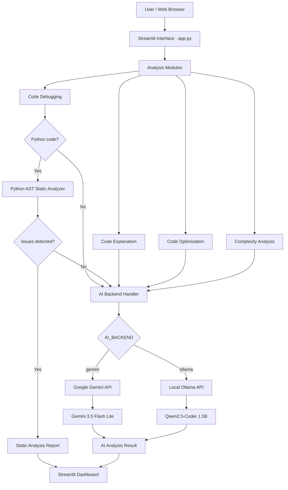

# CodeGenie — System Architecture and Workflow

## 1. Introduction

CodeGenie is an AI-powered code explanation and debugging assistant developed using Python, Streamlit, Google Gemini, Ollama, and Qwen2.5-Coder 1.5B.

The application helps users understand programming code, identify potential errors, receive optimization suggestions, and estimate algorithmic complexity.

CodeGenie supports Python, Java, C, and C++ and provides four primary operations:

- Code Explanation
- Code Debugging
- Code Optimization
- Complexity Analysis

The application supports two AI inference modes:

1. **Cloud Mode:** Google Gemini 3.5 Flash Lite through the Gemini API.
2. **Local Mode:** Qwen2.5-Coder 1.5B through Ollama.

The cloud version is deployed on Streamlit Community Cloud, allowing users to access CodeGenie through a public web browser without installing Python or Ollama.

**Live Application:** https://codegenie-ai-code-assistant-h8jebagittpvxrsiaceua6.streamlit.app

## 2. System Architecture

CodeGenie follows a modular architecture consisting of the presentation layer, analysis layer, static-analysis component, AI backend handler, and AI inference layer.

### 2.1 System Architecture Diagram



### 2.2 Presentation Layer

The Streamlit application (`app.py`) provides the user interface.

Its responsibilities include:

- Accepting programming code through the code editor.
- Allowing users to select Python, Java, C, or C++.
- Providing four code analysis operations.
- Loading sample Python programs.
- Displaying syntax-highlighted code previews.
- Showing the configured AI backend and model.
- Displaying AI-generated analysis results.
- Allowing users to download analysis results as text files.

The dashboard uses custom CSS for a dark-themed interface.

### 2.3 Analysis Layer

The application contains four primary analysis modules.

| Module | Responsibility |
|---|---|
| `code_explainer.py` | Generates beginner-friendly code explanations |
| `code_debugger.py` | Identifies potential errors and suggests corrections |
| `code_optimizer.py` | Suggests improvements in code readability and efficiency |
| `complexity_analyzer.py` | Estimates algorithmic time and auxiliary space complexity |

Each module processes its corresponding operation and uses the AI backend handler when model inference is required.

### 2.4 Static Analysis Component

The `python_analyzer.py` module uses Python's Abstract Syntax Tree (AST) to perform selected static-analysis checks without executing submitted programs.

Supported checks include selected Python syntax errors and function argument mismatches.

For Python debugging:

1. The static analyzer examines the submitted code.
2. If supported issues are detected, the debugger returns a predefined static-analysis report.
3. Otherwise, the request is forwarded to the configured AI backend.

The static analyzer does not provide complete program verification and is not a replacement for executing or testing the code.

### 2.5 AI Backend Handler

The `utils/llm_handler.py` module manages communication with the selected AI backend.

Its responsibilities include:

- Receiving submitted code, programming language, and analysis operation.
- Constructing task-specific prompts.
- Reading backend configuration.
- Selecting Google Gemini or Ollama.
- Sending HTTP requests using the Requests library.
- Processing API responses.
- Handling connection failures, timeouts, and API errors.
- Returning the generated analysis to the selected module.

The application uses the `AI_BACKEND` configuration value to select the inference backend.

Supported values:

```text
gemini
ollama
```

The backend handler preserves local Ollama support while enabling hosted Gemini inference.

### 2.6 AI Inference Layer

CodeGenie supports two AI inference backends.

#### A. Google Gemini Cloud Backend

The cloud backend uses the Google Gemini API.

**AI Model:** Gemini 3.5 Flash Lite

**API Method:** HTTP POST

**API Endpoint:**

```text
https://generativelanguage.googleapis.com/v1beta/models/{model}:generateContent
```

The backend sends task-specific prompts and receives AI-generated responses.

The Gemini API key is configured privately using environment variables or Streamlit secrets.

Cloud inference requires internet connectivity and is subject to API availability, rate limits, and usage quotas.

#### B. Local Ollama Backend

The local backend uses Ollama to run Qwen2.5-Coder 1.5B.

**AI Model:** Qwen2.5-Coder 1.5B

**API Method:** HTTP POST

**Default API Endpoint:**

```text
http://localhost:11434/api/generate
```

The backend sends prompts to the locally running Ollama service and receives generated responses.

Local inference does not require a Gemini API key.

The Ollama service and downloaded model must be available on the user's computer.

### 2.7 Backend Configuration

The backend can be configured using the following environment variables:

| Variable | Purpose | Example |
|---|---|---|
| `AI_BACKEND` | Selects the AI backend | `gemini` or `ollama` |
| `GEMINI_MODEL` | Selects the Gemini model | `gemini-3.5-flash-lite` |
| `GEMINI_API_KEY` | Authenticates Gemini API requests | Private API key |
| `OLLAMA_MODEL` | Selects the local model | `qwen2.5-coder:1.5b` |
| `OLLAMA_URL` | Configures the local API endpoint | `http://localhost:11434/api/generate` |

The backend handler reads these values through Python's `os.getenv()` function.

When no backend is configured, the application defaults to Ollama.

## 3. System Workflow

### 3.1 General Workflow

1. The user opens CodeGenie through the deployed website or local Streamlit application.
2. The user enters programming code.
3. The user selects Python, Java, C, or C++.
4. The user selects Explain Code, Debug Code, Optimize Code, or Analyze Complexity.
5. Streamlit forwards the request to the appropriate analysis module.
6. For Python debugging, selected static-analysis checks run first.
7. If supported issues are detected, the application returns a static-analysis report.
8. Otherwise, the request is forwarded to the AI backend handler.
9. The handler constructs a task-specific prompt.
10. The configured backend processes the prompt using Gemini or Ollama.
11. The generated analysis is returned to the Streamlit dashboard.
12. The user reviews the response and may download it as a text file.

### 3.2 Cloud Workflow

**User → Streamlit Community Cloud → Streamlit Application → Analysis Module → Gemini API → Gemini 3.5 Flash Lite → Analysis Result**

Cloud Mode allows users to access CodeGenie through a browser without installing the local AI model.

### 3.3 Local Workflow

**User → Local Streamlit Application → Analysis Module → Ollama API → Qwen2.5-Coder 1.5B → Analysis Result**

Local Mode runs the AI model on the user's computer.

### 3.4 Python Debugging Workflow

**Python Code → AST Static Analyzer → Error Detection**

If supported errors are detected:

**Static Analyzer → Static Analysis Report → Streamlit Dashboard**

Otherwise:

**Static Analyzer → AI Backend Handler → Configured AI Model → Streamlit Dashboard**

This approach combines selected deterministic static checks with generative AI analysis.

## 4. Technologies

| Technology | Purpose |
|---|---|
| Python | Backend application development |
| Streamlit | Interactive web application |
| Google Gemini API | Hosted AI inference |
| Gemini 3.5 Flash Lite | Cloud AI model |
| Ollama | Local AI model runtime |
| Qwen2.5-Coder 1.5B | Local code analysis model |
| Requests | HTTP communication with AI APIs |
| Python AST | Selected Python static-analysis checks |
| Pygments | Installed syntax-highlighting library |
| Python-dotenv | Environment configuration support |
| HTML/CSS | Dashboard customization |
| GitHub | Source code hosting and version control |
| Streamlit Community Cloud | Public application deployment |

## 5. Advantages

- Supports both cloud and local AI inference.
- Provides a publicly accessible web application.
- Preserves local Ollama functionality.
- Supports four programming languages.
- Provides code explanation, debugging, optimization, and complexity analysis.
- Uses modular Python components.
- Performs selected static-analysis checks for Python.
- Offers a beginner-friendly interface.
- Provides syntax-highlighted code previews.
- Supports downloadable AI analysis results.
- Allows backend selection through configuration.
- Uses private API key configuration for cloud inference.

### 5.1 Deployment Architecture

CodeGenie is hosted on Streamlit Community Cloud.

The deployment uses the GitHub repository as its source code.

**Repository:** https://github.com/Adi-20221COM0087/codegenie-ai-code-assistant

**Live Application:** https://codegenie-ai-code-assistant-h8jebagittpvxrsiaceua6.streamlit.app

Deployment configuration:

| Setting | Value |
|---|---|
| Hosting Platform | Streamlit Community Cloud |
| Repository | `Adi-20221COM0087/codegenie-ai-code-assistant` |
| Branch | `main` |
| Entry Point | `app.py` |
| Cloud AI Backend | Google Gemini |
| Cloud AI Model | Gemini 3.5 Flash Lite |

The deployment installs application dependencies from `requirements.txt`.

The hosted application communicates with the Gemini API through HTTPS.

Local Ollama inference remains available when the project is run on a computer with Ollama installed.

### 5.2 Security Considerations

The Gemini API key must be kept private.

For local configuration, the application can use environment variables or a private `.streamlit/secrets.toml` file.

For cloud deployment, sensitive values should be configured through Streamlit Community Cloud's secrets management.

Example configuration:

```toml
AI_BACKEND = "gemini"
GEMINI_MODEL = "gemini-3.5-flash-lite"
GEMINI_API_KEY = "YOUR_PRIVATE_GEMINI_API_KEY"
```

The `.gitignore` file excludes local environment files and `.streamlit/secrets.toml` from normal Git tracking.

Actual API keys must never be committed to GitHub or included in screenshots.

The application does not execute submitted code. However, submitted code sent to Gemini is transmitted to Google's hosted API for processing.

Users should avoid submitting passwords, private credentials, or confidential source code.

## 6. Limitations

- The application does not execute submitted code.
- AI-generated explanations and suggestions may be inaccurate.
- The AST analyzer detects only selected Python error patterns.
- Complexity estimates are not formally verified.
- Local Ollama inference depends on available hardware.
- Local Mode requires Ollama and the downloaded model.
- Cloud Mode requires internet access and a valid Gemini API key.
- Cloud API requests may be affected by quotas, rate limits, and service interruptions.
- Streamlit Community Cloud applications may sleep when inactive.
- The hosted deployment is configured for Gemini rather than a local Ollama server.
- AI-generated results should be reviewed before use.

## 7. Conclusion

CodeGenie demonstrates the integration of generative AI, static program analysis, modular Python development, and an interactive web interface to support programming education and code review.

The application combines local inference through Ollama and Qwen2.5-Coder 1.5B with cloud inference through the Google Gemini API.

Deployment on Streamlit Community Cloud makes the application accessible through a public web link without requiring visitors to install Python or Ollama.

CodeGenie provides a practical example of a dual-backend generative AI application supporting code explanation, debugging, optimization, and complexity analysis.
